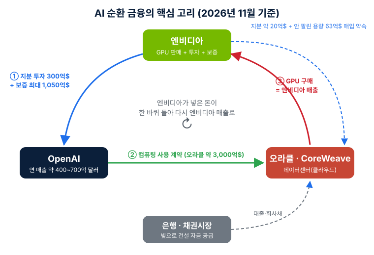
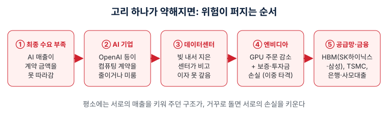

## 들어가며
- 이번 주 AI 시장의 가장 큰 뉴스는 **젠슨 황 엔비디아 CEO의 사임(11월 12일)**이다. 엔비디아 주가는 장중 13% 넘게 빠졌고, 10월 6일 고점($239.24) 대비 시가총액이 **약 1.8~2조 달러** 사라졌다.
- 시장이 진짜로 겁내는 건 CEO 한 명이 아니다. 황이 직접 짜 온 **"엔비디아가 고객에게 돈을 대고, 그 고객이 그 돈으로 엔비디아 칩을 사는" 구조**, 즉 **AI 순환 금융**이 흔들릴 수 있다는 점이다.
- 이 글은 그 구조가 무엇인지, 왜 위험한지, 앞으로 어떻게 될지를 **핵심만** 정리한다.

> 공부용 정리이며 투자 추천이 아니다. 숫자는 작성 시점(2026-11-15) 기준이고, 출처마다 금액이 다른 경우 보수적인 쪽 또는 공시 기준을 썼다.

### 한 줄 결론
> **순환 금융 자체가 곧 사기나 버블은 아니다. 문제는 "최종 고객의 실제 돈"이 이 고리를 언제까지 채워 줄 수 있느냐다.** 지금은 금리 인상 + 빚 의존 + 엔비디아 리더십 공백이 한꺼번에 겹치면서, 고리의 **가장 약한 곳(빚 많은 데이터센터 업체)부터** 압력이 보이기 시작했다.

## 1. 순환 출자? 순환 금융? 개념부터
- 한국에서 **순환 출자**는 원래 재벌 지배구조 용어다. A사가 B사 지분을, B사가 C사 지분을, C사가 다시 A사 지분을 갖는 식으로 **같은 돈이 돌면서 자본이 부풀어 보이는 구조**다.
- AI 쪽에서 말하는 건 정확히는 **순환 금융(circular financing)** 또는 **벤더 파이낸싱(vendor financing)**이다. 핵심은 같다.

```
공급자가 고객에게 돈을 준다 (투자·대출·보증)
      ↓
고객이 그 돈으로 공급자의 물건을 산다
      ↓
공급자의 매출이 늘고 주가가 오른다 → 더 큰 돈을 다시 고객에게 준다
```

- **문제가 되는 이유는 하나다.** 매출이 "진짜 바깥 수요"에서 온 것인지, "내가 준 돈이 돌아온 것"인지 **구분이 흐려진다.**
- 역사적 선례: 1990년대 말 **루슨트·노텔** 같은 통신장비 회사들이 통신사에 돈을 빌려주고 장비를 팔았다. 2000~2002년 통신사들이 줄줄이 파산하자 **장비 매출과 빌려준 돈이 동시에** 무너졌다.

## 2. 지금 구조는 어떻게 생겼나



### 핵심 거래만 추리면

| 관계 | 내용 | 규모 |
|---|---|---|
| 엔비디아 → OpenAI | 지분 투자 (2026년 1,220억 달러 펀딩 라운드 참여) | **300억 달러** |
| 엔비디아 → OpenAI 오하이오 데이터센터 | OpenAI가 임대료를 못 내면 엔비디아가 메워 주는 보증 (2028년 이후 단계적으로 적용) | **최대 1,050억 달러** |
| OpenAI → 오라클 | 5년간 컴퓨팅 사용 계약 | 약 3,000억 달러 |
| OpenAI → 마이크로소프트 | Azure 사용 계약 (MS는 OpenAI 대주주) | 약 2,500억 달러 |
| OpenAI ↔ AMD | AMD 칩을 사는 대신 AMD 지분 최대 약 10%를 받는 워런트 | 매출 잠재력 약 900억 달러 |
| 엔비디아 → CoreWeave | 지분 약 20억 달러 + **팔리지 않은 용량을 사 주겠다는 약속** | 63억 달러 |
| 엔비디아 → AI 클라우드 전반 | 미판매 용량 되사기 약속 | 360억 달러 |
| 엔비디아 → Anthropic, xAI(현 SpaceX), Nebius, 인텔 등 | 지분 투자 | 투자 자산 합계 **약 990억 달러** (1년 전 약 70억 달러) |

- 블룸버그는 엔비디아가 발표했거나 논의 중인 주요 AI 거래를 **최소 7,500억 달러**로 집계했다. 시장에서 엔비디아를 **"AI 중앙은행"**이라고 부르는 이유다.
- OpenAI가 여러 회사와 맺은 컴퓨팅 구매 약속은 계산 방식에 따라 **6,000억 ~ 1.4조 달러**다. 반면 OpenAI 연 매출(런레이트)은 **400억~700억 달러 수준**이고, 흑자 전환은 2029~2030년 이후로 본다.
  - 즉, **매출의 10~20년치를 미리 약속**해 둔 셈이다.

### 돈은 어디서 오나: 점점 "빚"이 된다
- 빅테크 4사(아마존·알파벳·MS·메타)의 2026년 설비투자(capex)는 **약 7,200억~7,450억 달러**다.
- 미 재무부 자문위원회(TBAC) 자료에 따르면 테크 업계 capex는 **2026년 약 1조 → 2027년 1.7조 달러**로 늘지만, 영업현금흐름은 2027년 1.1조 달러에 그친다. **2027년에만 6,000억 달러 이상 부족**하고, 이를 약 7,350억 달러의 신규 부채로 메울 것으로 본다.
- 하이퍼스케일러 회사채 발행은 올해만 **2,960억 달러**, 내년 전망은 4,400억 달러(골드만삭스). 3분기에는 빅테크들이 **capex가 영업현금을 넘어 잉여현금흐름이 마이너스**였다.

## 3. 왜 위험한가 — 4가지만 기억하면 된다



### ① 수요 착시
- 엔비디아 매출 중 일부는 **엔비디아가 직접 또는 보증으로 대 준 돈**에서 나온다. 그만큼 "AI 수요"가 실제보다 크게 보일 수 있다.
- WSJ 보도(2차 인용)에 따르면, 엔비디아는 **칩이 남는데도 값을 내리지 않고, 대신 고객에게 돈을 대 줘서 원래 값에 사게 했다.** 그래서 겉으로는 "비싸게 잘 팔린다"로 보이지만, 실제 수요보다 부풀려졌을 수 있다. (엔비디아는 '순환 금융'이라는 표현 자체를 부인해 왔다.)

### ② 위험이 한 곳에 몰린다 — 엔비디아는 "이중 타격"
- OpenAI 같은 고객이 흔들리면 엔비디아는 **GPU 주문이 줄고, 동시에 투자금·보증에서도 손실**을 본다. 평소엔 서로 매출을 키우던 고리가, 거꾸로 돌면 서로 손실을 키운다.
- 엔비디아 10-Q 기준 고객 지원성 약정(보증·되사기·리스 등)은 **4월 35억 달러 → 7월 1,645억 달러**로 한 분기 만에 폭증했다. 엔비디아도 공시에서 "거래상대방·실행 위험에 노출된다"고 직접 경고했다.

### ③ 빚으로 짓는 중인데, 금리가 오른다
- 미 연준은 9월 16일 **2023년 이후 첫 금리 인상**(3.75~4.00%)을 했고, 12월 추가 인상 확률이 **약 77%**까지 올랐다(CME FedWatch, 11월 6일).
- AI 데이터센터는 **"오늘 빚을 내서 짓고, 수년 뒤 임대료로 갚는"** 사업이다. 금리가 오르면 이 계산이 바로 틀어진다.

### ④ 가장 약한 고리가 이미 신호를 보낸다
신용시장이 먼저 반응하고 있다. 숫자가 높을수록 "부도 위험이 크다"고 보는 것이다.

| 지표 (11월 초) | 수준 | 의미 |
|---|---|---|
| CoreWeave 2032년 만기 채권 수익률 | **16% 이상** (쿠폰 9.6%) | 정크 중에서도 위험한 수준 |
| CoreWeave 5년 CDS | 약 1,100~1,290bp | 5년 내 부도 확률 약 60%로 환산 |
| 오라클 CDS | 약 290~300bp | **2008년 금융위기 때보다 높음** |
| 엔비디아 CDS | 약 139bp (한 달 새 +76%) | 절대 수준은 낮지만 상승 |

- 오라클 관련 데이터센터 건설 대출 **380억 달러**를 은행들이 팔려고 하는데, 일부는 할인 매각 중이다.
- CoreWeave는 2027년 만기 원금 약 110억 달러 대비 유동성이 약 98억 달러다. **엔비디아라는 "보증인"의 존재감이 조달 금리를 6%대로 낮춰 주던 구조**라, 황의 사임이 특히 아프다.

## 4. 반대 의견: "버블 확정은 아니다"
공정하게 보면 반론도 탄탄하다.
- **루슨트와 다른 점:** 엔비디아는 빚이 거의 없고 현금이 넘친다. 고객도 대부분 마이크로소프트·아마존·구글·메타처럼 **돈을 실제로 버는 회사**다. 전 미 FDIC 의장 실라 베어도 "엔비디아는 은행처럼 망하면 안 되는(too big to fail) 회사가 아니다"라고 했다.
- **수요가 진짜 늘고 있다:** Anthropic 연 매출 런레이트가 10월 **810억 달러**, OpenAI도 400억~700억 달러로 1년 새 몇 배가 됐다.
- **재무부 자문위원회(TBAC):** "순환 금융은 버그가 아니라 **특징(feature)**"이라고 했다. 일부 업체가 망해도 **데이터센터라는 물리적 인프라는 다른 수요처를 찾는다**는 논리다. 다만 "업계 전체가 튼튼하다고 개별 차입자의 약점이 가려져선 안 된다"고 경고도 붙였다.
- **이미 서명된 약정은 그대로다:** 황의 사임으로 계약이 자동 해지되는 조항은 없다. 흔들리는 건 **앞으로 새로 해 줄 지원**이다.

> 정리하면: **"순환 구조가 있다" = 버블**이 아니라, **"순환 구조 + 최종 매출이 못 따라옴 + 빚과 금리" = 위험**이다. 지금은 앞의 두 개가 아직 판정 전이고, 뒤의 것이 나빠지는 중이다.

## 5. 앞으로 어떻게 될까

### 단기에 확인할 일정

| 날짜 | 이벤트 | 볼 것 |
|---|---|---|
| **11/17** | 엔비디아 3분기 실적 (크레스 임시 CEO 첫 발표) | 가이던스 1,080억 달러 달성 여부, **보증·투자 약정 규모와 축소 여부** |
| **11/18~19** | Anthropic 나스닥 상장 (목표 기업가치 약 1.4조 달러) | 공모 흥행 여부 = 시장이 AI 기업 가치를 아직 믿는지 |
| **12월** | FOMC | 추가 인상 시 데이터센터 차입 비용 상승 |
| **2027년** | CoreWeave 등 네오클라우드 회사채 만기, OpenAI 추가 자금 조달·IPO | 차환(롤오버) 성공 여부 |

### 시나리오 (개인적 판단)

```
[가장 가능성 높음] 질서 있는 감속
 - 엔비디아가 새 보증·투자를 줄이고 "돈 대주며 파는" 비중을 낮춘다
 - 빅테크는 투자를 계속하지만 속도 조절, 빚 많은 네오클라우드는 구조조정·인수합병
 - 엔비디아 주가는 '성장 프리미엄'이 줄어 박스권, 실적은 계속 성장

[위험 시나리오] 약한 고리부터 연쇄 균열
 - 금리 추가 인상 + OpenAI 조달 실패/지연 → 컴퓨팅 계약 축소
 - CoreWeave류 업체 차환 실패 → 엔비디아 보증·되사기 약정 현실화
 - GPU 중고 가격 하락 → GPU 담보 대출 부실 → 은행·사모대출로 전이

[낙관 시나리오] 매출이 고리를 따라잡는다
 - AI 에이전트·기업용 매출이 급증해 OpenAI·Anthropic이 약속을 스스로 감당
 - 순환 금융은 "초기 마중물"이었던 것으로 정리
```

- **내 결론:** 2000년 닷컴처럼 한 번에 무너지기보다는, **"엔비디아의 돈줄 역할 축소 → 빚에 의존한 2군 업체 정리 → 살아남은 빅테크 중심 재편"**으로 갈 가능성이 크다. 크레스 임시 CEO는 이미 오하이오 보증을 2,500억 → 약 1,200억 달러 수준으로 줄이는 데 관여했고, 거래 선정·보증 평가 방식을 재검토 중인 것으로 보도됐다. **새 CEO 체제의 엔비디아는 "AI 중앙은행" 역할을 덜 할 가능성이 높다.**
- 이 경우 가장 먼저 아픈 곳은 **엔비디아 자금에 기대던 네오클라우드(CoreWeave, Nebius 등)와 오라클**, 그다음이 **OpenAI의 투자 속도**다. 엔비디아 자체는 보증 부담이 줄어 재무적으로는 오히려 안전해질 수 있다.
- **한국 투자자 관점:** SK하이닉스·삼성전자의 HBM 수요는 결국 이 고리 끝에 달려 있다. 빅테크 capex가 유지되는 한 단기 수요는 버티지만, **순환 금융으로 부풀었던 "추가분"이 빠지면 2027년 증설 속도에 영향**을 줄 수 있다.

## 정리
1. **순환 금융** = 엔비디아가 고객에게 돈(투자·보증)을 대고, 고객이 그 돈으로 엔비디아 칩을 사는 구조. 엔비디아의 관련 약정은 수천억 달러 규모다.
2. **위험의 본질**은 구조 자체보다 **최종 매출이 따라오느냐**, 그리고 그 사이를 **빚으로 메우고 있다**는 점이다. 금리가 오르면서 가장 약한 고리(CoreWeave, 오라클)의 신용 지표가 먼저 나빠졌다.
3. **젠슨 황 사임**으로 이 고리의 "보증인"이 흔들렸다. 이미 맺은 계약은 유지되지만 **새로운 지원은 줄어들 가능성이 크다.**
4. **전망**: 급격한 붕괴보다는 **질서 있는 감속과 재편**이 기본 시나리오. 11/17 엔비디아 실적, 11/19 Anthropic 상장, 12월 FOMC, 2027년 채권 만기가 분기점이다.

## 참고 자료
- [Nvidia 8-K: CEO 교체 공시 (SEC)](https://www.sec.gov/Archives/edgar/data/0001045810/000104581026000082/nvidiaannouncesceotransiti.htm)
- [CNBC — Nvidia CEO Jensen Huang resigns: Live updates](https://www.cnbc.com/2026/11/12/nvidia-jensen-huang-ceo-live-updates.html)
- [CNBC — CoreWeave bond yield tops 16% as AI credit stress rises](https://www.cnbc.com/2026/11/06/coreweave-bond-yield-tops-16percent-as-ai-credit-stress-rises.html)
- [CNBC — Nvidia's investments grow to $99 billion](https://www.cnbc.com/2026/09/04/nvidia-ai-investments-99-billion.html)
- [Yahoo Finance — AI's circular financing is a 'feature,' not a bug (TBAC)](https://finance.yahoo.com/markets/article/ais-circular-financing-is-a-feature-not-a-bug-wall-streets-elite-bond-committee-tells-treasury-155811224.html)
- [Yahoo Finance — Nvidia, OpenAI, and Oracle's financing circle hit its first stress test: a Fed rate hike](https://finance.yahoo.com/economy/policy/articles/nvidia-openai-oracles-745b-financing-135702453.html)
- [Bloomberg — AI Circular Deals: How Microsoft, OpenAI and Nvidia Keep Paying Each Other](https://www.bloomberg.com/graphics/2026-ai-circular-deals/)
- [White Cloud Research — Nvidia lost its CEO. Its customers lost their guarantor.](https://whitecloudresearch.substack.com/p/nvidia-lost-its-ceo-its-customers)
- [TechSpot — Nvidia kept GPU prices high through circular financing deals, report claims (WSJ 인용)](https://www.techspot.com/news/114558-nvidia-deliberately-kept-gpu-prices-high-through-circular.html)
- [24/7 Wall St. — Nvidia's new CEO Colette Kress seems tougher on OpenAI](https://247wallst.com/investing/2026/11/13/nvidias-new-ceo-colette-kress-seems-tougher-on-openai-than-huang-was/)
- [파이낸셜뉴스 — Shaken AI 'Circular Finance' Ecosystem](https://en.fnnews.com/news/202611141730429438)
- [국민일보 — 'AI 중앙은행' 이끌었는데⋯ 순환거래 생태계 '돈맥경화' 우려](https://www.kmib.co.kr/article/20261113500670)
- [The Conversation — Who's paying whom? The circular money machine behind the AI boom](https://theconversation.com/whos-paying-whom-the-circular-money-machine-behind-the-ai-boom-or-bubble-293938)
- [Tomasz Tunguz — OpenAI's $1 Trillion Infrastructure Spend](https://tomtunguz.com/openai-hardware-spending-2025-2035/)
